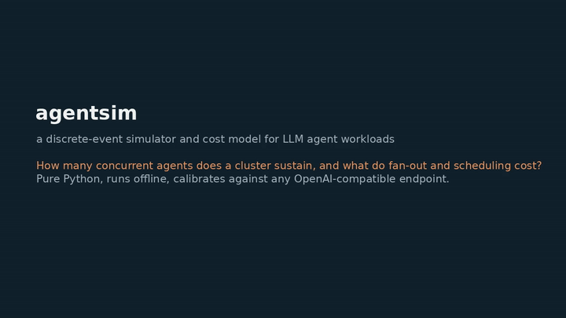
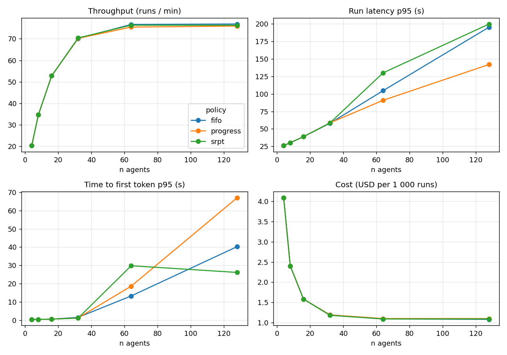
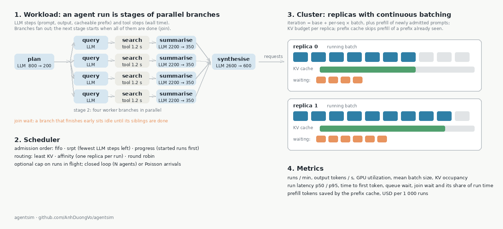

# agentsim

## What this project demonstrates

Demonstrates how explicit serving-model assumptions affect agent latency, throughput and estimated cost. Default outputs are modeled, not measured GPU performance.

## Watch the demo



[Portfolio videos](https://anhduongvo.github.io/projects/agent-workload-sim/). Clinical recordings use the separate simplified interactive demo.

## Try it offline

Python 3.11–3.13. In a fresh virtual environment, from this repository:

```bash
python -m venv .venv
source .venv/bin/activate
python -m pip install -e ".[dev]"
agentsim run --profile fanout --runs 20 --gpus 2 --agents 4
pytest -q
```

## Run with NVIDIA or another configured backend

NVIDIA is optional: benchmark a running OpenAI-compatible endpoint with streaming usage. Set `AGENTSIM_API_KEY` if required. `--model` must name a served model. Failures remain in the measurement report. Validate the fit on held-out workloads.

Model IDs in `.env.example` and NAT configs are examples, not a current availability guarantee. Check your endpoint before running; the validation below does not include live model execution.

## What is verified

Simulation behavior and mocked benchmark token accounting. Server token usage is distinct from content chunks; estimates are labelled and excluded from token-latency calibration. Effective decode interval is an aggregate approximation.

| Validation layer | Status |
|---|---|
| Unit/regression tests | Executed locally on Python 3.12; see `docs/validation.md` |
| Mocked/simulated integrations | Executed locally; scope documented in tests |
| Live hosted endpoints | Not executed; access and appropriate inputs required |
| Self-hosted GPU endpoints | Not executed |
| Domain-specific validation | Not completed; synthetic examples only |

See [validation details](docs/validation.md). The architecture and detailed workflows follow.

## Architecture and detailed workflows

**A discrete-event simulator and cost model for LLM agent workloads.** An agent run is not one prompt but a graph of LLM calls, tool calls and waits, often with sub-agents fanning out and joining again. agentsim replays thousands of such runs against a model of a serving cluster (replicas with continuous batching, a KV-cache budget, a prefix cache, a scheduler) and reports throughput, latency percentiles, time lost at synchronization points, GPU utilization and cost per run. It answers questions like: how many concurrent agents do two GPUs sustain before p95 latency doubles, what does the fan-out in a research agent cost, does a shortest-job-first scheduler help the short runs without starving the long ones, and is the prefix cache worth anything for this workload.

It is pure Python with one dependency (pydantic), runs a 300-run sweep in a few seconds, and can be calibrated against a real endpoint with the bundled benchmark.

## Demo


The recording runs the fan-out profile, compares fifo and srpt on a mixed workload, produces the sweep figure, and shows the benchmark and calibration steps. The video is on [anhduongvo.github.io](https://anhduongvo.github.io/projects/agent-workload-sim/).

## Results



*Mixed workload (50% single-turn chat, 30% ReAct loops, 20% fan-out research agents) on two replicas with a batch limit of 32, sweeping the number of concurrent agents for three admission policies. Throughput saturates at about 32 agents; beyond that, extra agents only add queueing: p95 run latency and time to first token climb while cost per run stops falling. The policies agree until the replicas saturate, then differ in whom they make wait.*

## How it works



**Workload.** A run is a list of stages. Each stage holds one or more branches that execute in parallel (a fan-out), and the next stage starts when all branches have finished (a join). A branch is a sequence of steps: an LLM call (prompt tokens, output tokens, an optional cacheable prefix) or a tool call (wall time, no GPU). Four synthetic profiles are built in, with token counts drawn around values typical of the clinical agents in this portfolio:

| Profile | Shape |
|---|---|
| `chat` | one LLM call |
| `react` | 3 to 7 think / tool / think iterations; the prompt grows with every observation |
| `fanout` | plan, then 4 to 8 parallel worker branches (query, search, summarise), then synthesise |
| `clinical` | extract, draft a long note, 6 to 12 parallel judge calls, revise (the shape of [consult-to-note](https://github.com/AnhDuongVo/consult-to-note)) |

Real traces from [agenteval](https://github.com/AnhDuongVo/agenteval) (OpenAI, LangGraph or LlamaIndex runs) are converted directly: `agentsim run --profile traces.jsonl`.

**Cluster.** A pool of identical replicas, each running one model copy with continuous batching. A decode iteration takes `iter_base_ms + iter_per_seq_ms × batch` and emits one token per running sequence; a newly admitted sequence adds `prompt_tokens / prefill_tokens_per_s` to the iteration that admits it. Each replica has a KV-cache budget in tokens (a request reserves prompt plus output) and a batch limit. With the prefix cache on, a prefix already seen on that replica is not prefilled again (LRU over a fixed number of prefixes).

**Scheduler.** Two decisions. Which waiting request a replica admits next: `fifo`, `srpt` (fewest LLM steps left in the run first), or `progress` (runs that have already started before runs that have not). Which replica a run goes to: `least_kv`, `affinity` (all steps of a run on one replica, for prefix locality), or `round_robin`. An optional admission limit caps runs in flight.

**Load.** Closed loop (`--agents N`: N agents, each starting its next run when the previous one ends) or open loop (`--rate R` arrivals per second, Poisson).

**Metrics.** Runs per minute, output tokens per second, run latency p50/p95, time to first token p50/p95, mean queue wait, mean join wait (time a branch sits finished waiting for its siblings) and its share of run time, GPU utilization, mean running batch size, KV occupancy, prefill tokens saved by the prefix cache, and USD per 1 000 runs from a GPU-hour price.

## Quickstart

```bash
pip install -e ".[dev]"

agentsim run --profile fanout --runs 200 --gpus 2 --agents 32
agentsim run --profile chat:0.5,react:0.3,fanout:0.2 --runs 300 --gpus 2 --max-batch 32 --agents 128 --policy srpt
agentsim sweep --profile react --gpus 2 --agents 4,8,16,32,64 --policy fifo,srpt --out results/react.csv --plot results/react.png
bash examples/sweep.sh         # the figure above, plus a fan-out study over 1, 2, 4 and 8 replicas
```

Two results from the bundled profiles (defaults, seed 0). With 128 agents on two saturated replicas, `srpt` more than halves the median latency of chat and ReAct runs and pays for it with the fan-out runs:

| Profile | p50 latency, fifo | p50 latency, srpt |
|---|---|---|
| chat | 23.5 s | 10.0 s |
| react | 161.8 s | 56.3 s |
| fanout | 138.4 s | 168.3 s |

And for the fan-out profile at 32 agents, adding replicas cuts latency almost linearly while the share of run time spent waiting at joins stays around 11%, because the join wait is set by the spread of the branches rather than by queueing:

| Replicas | runs / min | p95 latency | join wait share | USD per 1 000 runs |
|---|---|---|---|---|
| 1 | 16.0 | 152 s | 0.10 | 2.61 |
| 2 | 28.1 | 85 s | 0.12 | 2.96 |
| 4 | 43.4 | 54 s | 0.11 | 3.84 |
| 8 | 58.8 | 38 s | 0.11 | 5.66 |

## Calibrating against a real endpoint

The default cluster parameters are of the order one sees for a ~8B model on one data-centre GPU. They are not measurements. To anchor the model, point the benchmark at any OpenAI-compatible server (vLLM, NIM, TGI, Ollama, a hosted API) and fit:

```bash
agentsim bench --url http://localhost:8000/v1 --model <model-id> --concurrency 1,4,16,64 --prompt-tokens 500,2000,8000 --out measurement.jsonl
agentsim calibrate measurement.jsonl --out cluster.json
agentsim run --cluster cluster.json --profile clinical --gpus 1 --agents 16
```

`bench` sends `concurrency` streaming requests at once and records time to first token and the mean inter-token interval. `calibrate` fits inter-token latency against batch size for the decode parameters and time to first token against prompt length for the prefill rate. An illustrative measurement is in `data/measurement_example.jsonl`.

## Using your own traces

```python
from agentsim import ClusterSpec, SchedulerSpec, simulate, summarize, load_runs

runs = load_runs("data/agenteval_traces.jsonl")  # agenteval records are converted automatically
res = simulate(runs * 40, ClusterSpec(n_gpus=2), SchedulerSpec(policy="srpt"), n_agents=16)
print(summarize(res))
```

Runs can also be written by hand or generated from your own orchestrator logs; the schema is in `schema.py` and `agentsim workload --profile clinical --out w.jsonl` writes an example file to copy from.

## What the model leaves out

- One model per replica; no tensor or pipeline parallelism, no disaggregated prefill and decode, no speculative decoding.
- Prefill is charged whole in the admitting iteration; chunked prefill and prefill/decode interference are not modelled.
- A request reserves prompt plus output KV tokens up front; real engines grow the KV allocation as tokens are produced, so KV occupancy here is an upper bound.
- Tool latency is an input, not a model; network, retries and rate limits are not simulated.
- Synthetic profiles are plausible, not measured. Calibrate, and use your own traces, before trusting absolute numbers. The relative comparisons (policy A versus B, 2 versus 4 replicas) are more robust than the absolute ones.

## Development

```bash
ruff check . && ruff format --check .
pytest          # closed-form latency, batching, queueing, joins, prefix cache, scheduling, calibration
```

## License

Apache-2.0.
